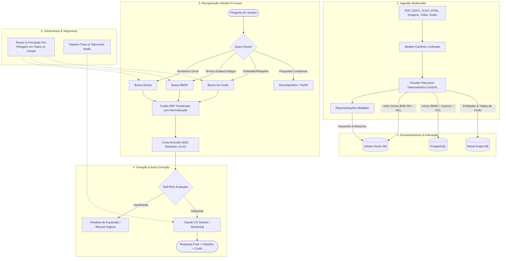

# Arquitetura RAG Multimodal, Híbrida e com Governança de Acesso (ACL)

Sistema de Recuperação e Geração Aumentada por Recuperação (RAG) de nível de produção, com suporte multimodal, recuperação híbrida tri-canal com RRF ponderado, enriquecimento por Grafo de Conhecimento (Graph RAG), roteamento semântico, cross-encoder reranking, Self-RAG adaptativo, observabilidade end-to-end, isolamento estrito de tenancy e controle de acesso granular (ACL).

---

## 🏛️ Visão Geral da Arquitetura



---

## 🚀 Principais Capacidades

1. **Ingestão Multimodal Canônica**:
   - Parsers unificados para texto, PDF, DOCX, XLSX, HTML, imagens (OCR + descrição visual), áudios e vídeos (keyframe detection + transcrição Whisper).
   - Chunks com identificadores determinísticos via UUIDv5 (`uuid5(CHUNK_NAMESPACE, doc_id:chunk_idx:hash)`).
   - Preservação da hierarquia Parent/Child (`parent_chunk_id` e `parent_content`).

2. **Recuperação Híbrida & Graph RAG**:
   - Fusão Reciprocal Rank Fusion (RRF) unificada e ponderada com suporte a canais Dense, BM25 e Grafo.
   - Graph RAG via Neo4j ou NetworkX (emulação in-memory) com propagação de tenant e ACL.
   - Roteamento adaptativo de queries e decomposição recursiva de sub-perguntas.

3. **Governança Estrita & Zero-Bypass de ACL**:
   - Pré-filtragem de `tenant_id` e `principals` em **todos** os canais antes do cálculo de similaridade e ranking.
   - Sentinel `ANY_PRINCIPAL` com validação de segurança fail-closed (`resolve_principals`).

4. **Geração Segura & Auto-Avaliação**:
   - **Self-RAG**: detecção de suficiência de contexto e recusa graciosa de alucinações.
   - Passagem de `prefetched_chunks` para evitar redundância de busca ou divergência de contexto.
   - Suporte a streaming com acúmulo de métricas, cache de resposta e registro contínuo de custo de tokens.

---

## 🛠️ Instalação e Execução

### 1. Pré-requisitos
- Python 3.10+
- Docker & Docker Compose (para Qdrant, Postgres, MinIO e Neo4j)

### 2. Configuração do Ambiente

```bash
# Clone o repositório
git clone https://github.com/ciecolopes01/arquiteturaRAG.git
cd arquiteturaRAG

# Crie e ative o ambiente virtual
python -m venv .venv
.venv\Scripts\activate  # No Linux/macOS: source .venv/bin/activate

# Instale as dependências
pip install -r requirements-dev.txt

# Configure as variáveis de ambiente
cp .env.example .env
```

### 3. Inicialização dos Serviços

```bash
docker-compose up -d
```

---

## 💻 Interface de Linha de Comando (CLI)

O script principal `rag.py` provê subcomandos completos para todas as operações do pipeline:

### Ingestão e Indexação
```bash
# Ingerir documento ou diretório no corpus
python rag.py ingest data/seed_corpus/01_conceitos_fundamentais.html

# Indexar todos os documentos ingeridos (Qdrant + Postgres + Grafo)
python rag.py index
```

### Busca e Recuperação
```bash
# Busca densa vetorial
python rag.py search "O que é chunking recursivo?" --mode dense --top-k 5

# Busca lexical BM25
python rag.py search "código tributário 504" --mode bm25 --top-k 5

# Busca híbrida com RRF
python rag.py search "Como funciona o RRF?" --mode hybrid --top-k 5

# Busca com isolamento por Tenant e Credenciais (ACL)
python rag.py search "Relatório de receitas" --tenant tenant_acme --principals user:joao,group:financeiro
```

### Geração de Respostas
```bash
# Resposta ponta a ponta com Claude
python rag.py answer "Qual a diferença entre dense e lexical search?"

# Resposta via streaming
python rag.py answer "Explique como funciona o Graph RAG" --stream
```

### Avaliação e Benchmarking
```bash
# Executar avaliação de Recall@K e MRR sobre o golden dataset
python rag.py evaluate --k 5 --mode hybrid

# Executar suíte comparativa completa de benchmarks
python rag.py benchmark
```

---

## 🧪 Testes Automatizados

O projeto utiliza `pytest` com categorização e suítes dedicadas:

```bash
# Executar verificação de segurança estática (AST)
pytest tests/test_security_ast.py -v

# Executar testes unitários e de latência offline
pytest tests/test_canonical_model.py tests/test_chunking.py tests/test_acl.py tests/test_optimization_latency.py -v

# Executar toda a suíte de testes
pytest
```

---

## 📁 Estrutura de Diretórios

```
arquiteturaRAG/
├── benchmarks/              # Configurações e suites de benchmark comparativo
│   └── configs/             # Arquivos YAML (pure_dense, bm25, hybrid_rrf, etc.)
├── data/                    # Corpus seed e golden datasets de avaliação
├── src/
│   ├── chunking/            # Chunkers recursivo e semântico (UUIDv5 determinístico)
│   ├── config.py            # Validação centralizada de configurações Pydantic
│   ├── embedding/           # Integração BGE-M3 e indexação no Qdrant
│   ├── evaluation/          # Plataforma de benchmark, golden dataset e métricas
│   ├── generation/          # Geração de respostas Claude, Self-RAG e streaming
│   ├── observability/       # Instrumentação de traces, latência e telemetria
│   ├── optimization/        # Caching de embeddings/queries e custos de tokens
│   ├── parsing/             # Parsers de documentos (PDF, DOCX, XLSX, HTML, multimídia)
│   ├── representation/      # Multi-vector representations e indexação
│   └── retrieval/           # Hybrid search, BM25, Graph search, ACL filtering, Reranker
├── tests/                   # Suíte de testes unitários, integração e segurança AST
├── docker-compose.yml       # Orquestração de containers de infraestrutura
├── pyproject.toml           # Configurações de ferramentas (pytest, ruff)
├── requirements.txt         # Dependências do projeto
└── requirements-dev.txt     # Dependências de desenvolvimento e testes
```
