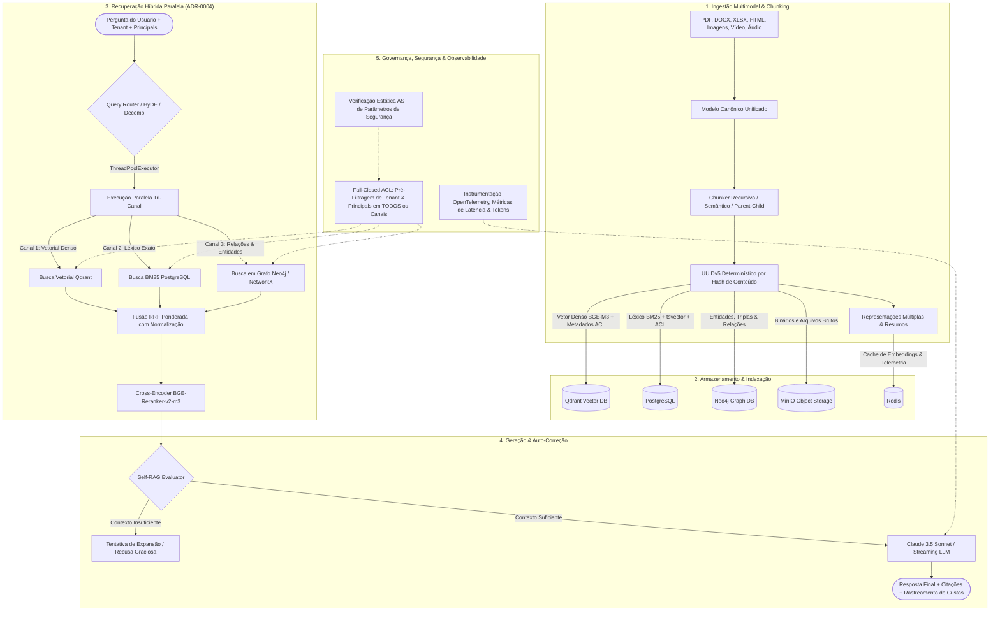
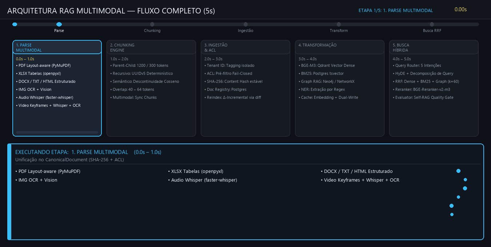

# Arquitetura RAG Multimodal, Híbrida e com Governança de Acesso (ACL)

Sistema de Recuperação e Geração Aumentada por Recuperação (RAG) de nível empresarial (*production-ready*), com suporte a dados multimodais, recuperação híbrida tri-canal com execução paralela, fusão via RRF ponderado, enriquecimento por Grafo de Conhecimento (Graph RAG), cross-encoder reranking, Self-RAG adaptativo com recusa segura, observabilidade completa com telemetria e controle estrito de acesso multi-tenant (*fail-closed* ACL).

---

## 🏛️ Visão Geral da Arquitetura



---

## 🎬 Demonstração Interativa & Fluxo em 5 Segundos



> 🎮 **Experimente a Demo Interativa Completa**: Abra [docs/rag_interactive_demo.html](docs/rag_interactive_demo.html) diretamente no seu navegador para testar a ingestão de diferentes arquivos (PDF, XLSX, Imagens, Áudio, Vídeo), inspecionar os chunks gerados e simular consultas em tempo real com busca tri-canal, cálculo de RRF e bloqueio por ACL.
>
> 💡 **Infográfico Animado & Exportador de Vídeo**: Abra [docs/rag_flow_infographic.html](docs/rag_flow_infographic.html) para ver a linha do tempo do fluxo em 5 segundos e gravar o vídeo em formato WebM nativo.

---

## 🧩 Estratégias de Chunking & Processamento de Documentos

O pipeline adota múltiplas abordagens de particionamento adaptadas à natureza de cada dado:

1. **Chunking Recursivo Determinístico**:
   - Divisão em múltiplos níveis de separadores (parágrafos, quebras de linha, pontuações e palavras) com controle estrito de tamanho (*chunk_size*) e sobreposição (*chunk_overlap*).
   - Identificadores únicos determinísticos via **UUIDv5** (`doc_id:chunk_idx:content_hash`) garantindo idempotência absoluta na reindexação ([ADR-0002](docs/adr/0002-deterministic-uuidv5-document-and-chunk-ids.md)).

2. **Chunking Semântico (*Semantic Chunking*)**:
   - Análise dinâmica de descontinuidades temáticas através de distância de cosseno entre embeddings de sentenças contíguas, segmentando o texto onde ocorre transição real de assunto.

3. **Chunking Hierárquico (*Parent-Child Chunking*)**:
   - Segmentos pequenos (*child chunks*) são gerados e indexados para máxima sensibilidade e precisão na recuperação.
   - No momento de resposta, o trecho maior contextualizador (*parent chunk*) é recuperado e fornecido ao LLM, evitando perda de contexto sem degradar a precisão da busca.

4. **Chunking Estruturado para Tabelas & Planilhas**:
   - Extração estruturada de arquivos XLSX e tabelas HTML/PDF, convertendo linhas em representações tabulares e Markdown preservando cabeçalhos e relações de colunas.

5. **Multi-Vector Representations & Resumos**:
   - Geração de múltiplos vetores para o mesmo documento (resumos executivos, palavras-chave geradas por LLM e texto bruto) para atender a diferentes padrões de perguntas.

---

## 🔍 Modalidades e Técnicas de Busca (Retrieval)

A plataforma implementa uma arquitetura multi-estratégia de recuperação de informação:

1. **Busca Vetorial Densa (*Dense Semantic Search*)**:
   - Indexação vetorial de 1024 dimensões com modelo `BGE-M3` e busca por similaridade de cosseno no **Qdrant**, capturando intenção, conceitos e variações semânticas.

2. **Busca Léxica Exata (*BM25 / Keyword Search*)**:
   - Busca por correspondência exata de termos técnicos, códigos de erro, identificadores ou cláusulas contratuais via **PostgreSQL** (`tsvector` e índice GIN) com algoritmo BM25.

3. **Busca em Grafo de Conhecimento (*Graph RAG*)**:
   - Navegação em grafo através de nós, entidades e relacionamentos conceituais no **Neo4j** (ou fallback com **NetworkX**), permitindo responder perguntas sobre relações indiretas e interdependências.

4. **Busca Híbrida Tri-Canal Concorrente (ADR-0004)**:
   - Execução em paralelo dos três canais (Dense + BM25 + Graph) utilizando `ThreadPoolExecutor` para minimizar latência total.

5. **Fusão via RRF Ponderado (*Reciprocal Rank Fusion*)**:
   - Combinação dos rankings parciais com normalização e ponderação personalizável (e auto-calibração com *Auto-Tune Fusion*).

6. **Re-ranqueamento com Cross-Encoder**:
   - Reavaliação e reordenação dos candidatos do top-K preliminar usando modelo `bge-reranker-v2-m3` com atenção cruzada entre query e trecho, eliminando falsos positivos.

7. **Roteamento Inteligente & Expansão de Consulta**:
   - **Query Router**: Roteador semântico que classifica o tipo de pergunta e escolhe o canal ideal.
   - **Query Decomposition**: Decomposição recursiva de perguntas complexas em sub-consultas atômicas.
   - **HyDE (*Hypothetical Document Embeddings*)**: Geração de respostas hipotéticas prévias para expandir consultas vagas antes da busca vetorial.

---

## 🛡️ Governança, Segurança e Self-RAG

- **Fail-Closed ACL Enforcement**: Pré-filtragem de segurança obrigatória (`tenant_id` e permissões de usuários/grupos) na raiz de todas as consultas antes de qualquer cálculo de relevância ([ADR-0001](docs/adr/0001-fail-closed-acl-enforcement.md)), validada por análise estática de código (AST).
- **Self-RAG Adaptativo**: Avaliação autônoma do grau de aderência e suficiência do contexto encontrado. Quando o conteúdo é insuficiente, o modelo realiza recusa graciosa em vez de inventar dados.
- **Connection Pooling & Thread-Safety**: Gestão de conexões resilientes para Qdrant, Postgres e Neo4j ([ADR-0003](docs/adr/0003-threaded-connection-pooling-and-thread-safety.md)).
- **Observabilidade Fim a Fim**: Métricas em tempo real de latência, contabilidade de tokens por requisição e cache de respostas e embeddings via Redis.

---

## 📐 Decisões de Arquitetura (ADRs)

As decisões de engenharia do sistema estão formalmente documentadas em Architecture Decision Records (ADRs):

- **[ADR-0001: Fail-Closed ACL Enforcement](docs/adr/0001-fail-closed-acl-enforcement.md)**: Aplicação obrigatória de filtros de tenant e permissões na raiz da consulta com bloqueio por padrão.
- **[ADR-0002: Deterministic UUIDv5 IDs](docs/adr/0002-deterministic-uuidv5-document-and-chunk-ids.md)**: Idempotência de ingestão e rastreabilidade através de identificadores determinísticos UUIDv5.
- **[ADR-0003: Threaded Connection Pooling](docs/adr/0003-threaded-connection-pooling-and-thread-safety.md)**: Gerenciamento de conexões seguras e pools thread-safe para PostgreSQL, Qdrant e Neo4j.
- **[ADR-0004: Multichannel Parallel Retrieval](docs/adr/0004-multichannel-parallel-retrieval.md)**: Paralelização da busca vetorial, léxica e em grafo para redução de latência no retrieval.

---

## 🛠️ Instalação e Configuração

### 1. Pré-requisitos
- Python 3.10+
- Docker & Docker Compose

### 2. Configuração do Ambiente

```bash
# Clone o repositório
git clone https://github.com/ciecolopes01/arquiteturaRAG.git
cd arquiteturaRAG

# Crie e ative o ambiente virtual
python -m venv .venv
.venv\Scripts\activate  # No Linux/macOS: source .venv/bin/activate

# Instale as dependências
pip install -r requirements-dev.txt

# Configure as variáveis de ambiente
cp .env.example .env
```

### 3. Inicialização dos Serviços

```bash
docker-compose up -d
```
Os seguintes serviços serão iniciados:
- **Qdrant** (Vector Database): portas `6333` e `6334`
- **PostgreSQL 16** (Busca Léxica BM25 e Catálogo): porta `5432`
- **Neo4j 5** (Base de Conhecimento em Grafo): portas `7474` (Web) e `7687` (Bolt)
- **Redis 7** (Cache e Telemetria): porta `6379`
- **MinIO** (Armazenamento de Objetos S3): portas `9000` (API) e `9001` (Console Web)

---

## 💻 Como Usar

### 1. Ingestão e Indexação do Corpus

Para processar os arquivos do diretório `data/seed_corpus` e indexá-los de forma incremental em todos os armazenamentos:

```bash
python scripts/reindex_all.py
```

### 2. Interface de Linha de Comando (CLI - `rag.py`)

O script `rag.py` provê subcomandos unificados para consulta, avaliação e benchmarks:

#### Geração de Respostas (`answer`)
```bash
# Pergunta direta com busca híbrida e resposta contextualizada
python rag.py answer "Qual a diferença entre busca densa e busca léxica?"

# Resposta via streaming token-a-token
python rag.py answer "Explique como funciona o Graph RAG" --stream

# Resposta com Adaptive Self-RAG (auto-avaliação e recusa segura)
python rag.py answer "Qual o faturamento previsto do projeto X?" --adaptive

# Consulta com isolamento de Tenant e controle de acesso (ACL)
python rag.py answer "Relatório de desempenho" --tenant tenant_acme --principals user:joao,group:financeiro --top-k 5
```

#### Benchmarking Comparativo (`benchmark`)
Executa a suíte comparativa de pipelines RAG (denso puro, BM25, híbrido com RRF, etc.) calculando Recall@K, MRR e latência média:
```bash
python rag.py benchmark --top-k 5
```

#### Avaliação Offline (`eval`)
Avalia a taxa de recuperação contra o *golden dataset* com métricas formais de IR:
```bash
# Avaliação no modo híbrido
python rag.py eval --mode hybrid --k 5 --tenant tenant-test

# Avaliação no modo vetorial denso
python rag.py eval --mode dense --k 5

# Avaliação no modo léxico BM25
python rag.py eval --mode bm25 --k 5
```

---

## 🧪 Testes Automatizados

O projeto conta com 37 suítes de testes automatizados com `pytest`:

```bash
# Executar verificação estática de segurança (AST) para invariantes de ACL
pytest tests/test_security_ast.py -v

# Executar testes unitários e de integração offline
pytest tests/test_canonical_model.py tests/test_chunking.py tests/test_acl.py tests/test_hybrid.py -v

# Executar todos os testes sem dependência de serviços externos
pytest -m "not integration" -v

# Executar a suíte completa
pytest
```

---

## 📁 Estrutura de Diretórios

```
arquiteturaRAG/
├── benchmarks/              # Configurações YAML e suítes comparativas de benchmark
│   └── configs/             # Perfis de teste (pure_dense, bm25, hybrid_rrf, etc.)
├── data/                    # Corpus seed e golden datasets de avaliação
├── demo/                    # Aplicação Web completa da Demo Local (FastAPI + Frontend)
│   ├── run_demo.bat         # Inicializador 1-clique para Windows
│   ├── run_demo.sh          # Inicializador 1-clique para Linux/macOS
│   ├── server.py            # Servidor FastAPI com upload, parse e busca real
│   └── static/index.html    # Interface web com drag & drop e dashboard RRF
├── docs/
│   ├── adr/                 # Architecture Decision Records (ADRs formais)
│   ├── rag_flow_5s.gif      # Animação do pipeline completo em 5 segundos
│   ├── rag_flow_infographic.html # Infográfico animado interativo com gravação de vídeo
│   └── rag_interactive_demo.html # Simulador interativo completo de Ingestão e Busca
├── scripts/                 # Scripts utilitários de geração de seeds e reindexação
│   └── reindex_all.py       # Reindexação incremental do corpus
├── src/
│   ├── chunking/            # Estratégias de chunking (recursivo, semântico, parent-child)
│   ├── config.py            # Validação centralizada de configurações Pydantic
│   ├── embedding/           # Integração com modelos de embeddings e Qdrant
│   ├── evaluation/          # Plataforma de benchmark, golden dataset e métricas IR
│   ├── generation/          # Geração com LLMs, streaming e Self-RAG adaptativo
│   ├── ingestion/           # Pipeline de ingestão e sincronização incremental
│   ├── observability/       # Instrumentação de traces, latência e métricas
│   ├── optimization/        # Caching de embeddings/queries e controle de custos
│   ├── parsing/             # Parsers de documentos (PDF, DOCX, XLSX, HTML, imagens, áudio, vídeo)
│   ├── representation/      # Multi-vector representations e indexação
│   └── retrieval/           # Busca híbrida paralela, BM25, Grafo, ACL e Cross-Encoder
├── tests/                   # 37 suítes de testes unitários, integração e segurança AST
├── docker-compose.yml       # Orquestração de containers (Qdrant, Postgres, Neo4j, Redis, MinIO)
├── pyproject.toml           # Configurações de ferramentas (pytest, ruff)
├── rag.py                   # CLI unificada da plataforma
├── requirements.txt         # Dependências de produção
└── requirements-dev.txt     # Dependências de desenvolvimento e testes
```

